# Diagrama entidad-relación: módulo Compras

Estado final del esquema `compras` después de ejecutar, en orden:

1. `database/schema/01_compras.sql`: tablas base.
2. `database/schema/02_ajustes_estados.sql`: estados nuevos de SC y OC, folios, `id_gestor`, `fecha_resolucion`, `fecha_creacion`, `fecha_recepcion_real`, `motivo_cancelacion`, `comentario`, CHECK e índices. Se elimina el estado `EN_RECEPCION` de la OC.
3. `database/schema/03_inventario.sql`: `cantidad` pasa a `INTEGER` en las dos tablas de líneas, se recrea `subtotal_linea` y se agregan las FK hacia `inventario.inv_producto`.

Convenciones del diagrama:

- **Línea continua (`--`)**: FK que existe en la BD.
- **Línea punteada (`..`)**: relación lógica **sin FK** en la BD, porque está pendiente (RRHH, Logística) o porque es polimórfica (historial).
- Las entidades con prefijo de otro schema (`inventario_`, `logistica_`, `rrhh_`) son **externas**: Compras solo las lee. De ellas solo se muestran las columnas que usa Compras (según `docs/decisiones.md` §1.1 y `backend/src/integracion`). Los tipos de esas columnas **no están en este repositorio** y se marcan como supuestos.
- Mermaid no acepta comas dentro del tipo, así que la precisión va en el comentario (`numeric` + `"(14,2)"`).

```mermaid
erDiagram
    %% ===================== Tablas propias (schema compras) =====================

    compras_proveedor {
        int     id_proveedor  PK "IDENTITY ALWAYS"
        varchar rut_nit       UK "(20) NOT NULL, RUT normalizado 76123456-0"
        varchar razon_social     "(150) NOT NULL"
        varchar email            "(120) NULL"
        varchar telefono         "(30) NULL"
        varchar direccion        "(200) NULL"
        varchar estado           "(10) NOT NULL DEFAULT ACTIVO, CHECK ACTIVO|INACTIVO"
    }

    compras_sc {
        int       id_solicitud     PK "IDENTITY ALWAYS"
        varchar   folio            UK "(20) NULL, SC-AAAA-NNNNN (lo asigna el backend)"
        int       id_empleado         "NOT NULL, solicitante (FK a rrhh_empleado pendiente)"
        timestamp fecha_solicitud     "NOT NULL DEFAULT now(), UTC, fecha de creación del borrador"
        varchar   motivo              "(300) NULL; NOT NULL salvo BORRADOR/ANULADA (chk_sc_motivo_enviada)"
        varchar   estado              "(12) NOT NULL DEFAULT BORRADOR, CHECK BORRADOR|PENDIENTE|APROBADA|RECHAZADA|ANULADA"
        varchar   motivo_rechazo      "(300) NULL; obligatorio si RECHAZADA (chk_sc_motivo_rechazo)"
        int       id_gestor           "NULL, quien aprobó o rechazó (FK pendiente)"
        timestamp fecha_resolucion    "NULL, UTC"
    }

    compras_sc_detalle {
        int     id_sc_detalle PK "IDENTITY ALWAYS"
        int     id_solicitud  FK "NOT NULL -> compras_sc"
        int     id_producto   FK "NOT NULL -> inventario.inv_producto"
        integer cantidad         "NOT NULL CHECK > 0"
    }

    compras_oc {
        int       id_oc                  PK "IDENTITY ALWAYS"
        varchar   folio                  UK "(20) NULL, OC-AAAA-NNNNN"
        int       id_proveedor           FK "NOT NULL -> compras_proveedor"
        int       id_empleado               "NOT NULL, comprador (FK pendiente)"
        timestamp fecha_creacion            "NOT NULL DEFAULT now(), UTC"
        timestamp fecha_emision             "NULL, UTC"
        date      fecha_entrega_esperada    "NULL; >= fecha_emision::date (chk_oc_fecha_entrega)"
        date      fecha_recepcion_real      "NULL, se llena al quedar COMPLETADA"
        numeric   subtotal                  "(14,2) NOT NULL DEFAULT 0"
        numeric   impuesto                  "(14,2) NOT NULL DEFAULT 0, IVA 19 %"
        numeric   total                     "(14,2) NOT NULL DEFAULT 0"
        varchar   estado                    "(15) NOT NULL DEFAULT BORRADOR, CHECK BORRADOR|EMITIDA|COMPLETADA|CON_PROBLEMAS|CANCELADA"
        varchar   motivo_cancelacion        "(300) NULL"
    }

    compras_detalle {
        int     id_detalle      PK "IDENTITY ALWAYS"
        int     id_oc           FK "NOT NULL -> compras_oc"
        int     id_sc_detalle   FK "NOT NULL -> compras_sc_detalle (respaldo, V7)"
        int     id_producto     FK "NOT NULL -> inventario.inv_producto"
        integer cantidad           "NOT NULL CHECK > 0"
        numeric precio_unitario    "(14,2) NOT NULL CHECK >= 0"
        numeric subtotal_linea     "(14,2) GENERATED ALWAYS AS cantidad*precio_unitario STORED"
    }

    compras_historial_estado {
        int       id_historial    PK "IDENTITY ALWAYS"
        varchar   tipo_documento     "(2) NOT NULL CHECK SC|OC"
        int       id_documento       "NOT NULL, id_solicitud o id_oc según tipo (sin FK)"
        varchar   estado_anterior    "(15) NULL (NULL = creación)"
        varchar   estado_nuevo       "(15) NOT NULL"
        int       id_empleado        "NOT NULL, quien hizo la transición (FK pendiente)"
        timestamp fecha              "NOT NULL DEFAULT now(), UTC"
        varchar   comentario         "(300) NULL, motivo de rechazo/cancelación/diferencias"
    }

    %% ===================== Entidades externas (solo lectura) =====================

    rrhh_rrhh_empleado {
        int     id_empleado PK "Hoy se lee logistica.test_log_rrhh_empleado (RRHH_EMPLEADO_TABLE)"
        varchar nombre         "tipo supuesto"
    }

    inventario_inv_temas {
        int     id_tema     PK
        varchar nombre_tema    "tipo supuesto"
    }

    inventario_inv_producto {
        int     id_producto PK
        int     id_tema     FK "-> inv_temas"
        varchar sku            "tipo supuesto"
        varchar nombre_set     "tipo supuesto"
        int     cant_piezas
        boolean activo
    }

    inventario_inv_stock_bodega {
        int id_producto         FK "-> inv_producto"
        int cantidad_disponible    "tipo supuesto; PK y bodega no verificadas"
    }

    logistica_log_recepcion {
        int       id              PK
        int       id_oc              "sin FK hacia compras_oc (pedida a Logística)"
        timestamp fecha_recepcion    "tipo supuesto, sin zona"
        varchar   estado             "valores desconocidos al 27/10/2026"
    }

    logistica_log_recepcion_detalle {
        int     recepcion_id      FK "-> log_recepcion.id (supuesto)"
        int     id_producto          "sin FK hacia inv_producto (pedida)"
        int     cantidad_recibida    "tipo supuesto"
        int     cantidad_danada      "tipo supuesto"
        varchar motivo_dano          "tipo supuesto"
        varchar observacion          "tipo supuesto"
    }

    %% ===================== Relaciones con FK real =====================
    compras_proveedor        ||--o{ compras_oc          : "id_proveedor"
    compras_sc               ||--o{ compras_sc_detalle  : "id_solicitud"
    compras_oc               ||--o{ compras_detalle     : "id_oc"
    compras_sc_detalle       ||--o{ compras_detalle     : "id_sc_detalle (máx. 1 OC no cancelada, solo en backend)"
    inventario_inv_producto  ||--o{ compras_sc_detalle  : "fk_compras_sc_det_producto"
    inventario_inv_producto  ||--o{ compras_detalle     : "fk_compras_det_producto"

    %% ===================== Relaciones lógicas sin FK =====================
    rrhh_rrhh_empleado       ||..o{ compras_sc               : "id_empleado (solicitante)"
    rrhh_rrhh_empleado       |o..o{ compras_sc               : "id_gestor"
    rrhh_rrhh_empleado       ||..o{ compras_oc               : "id_empleado (comprador)"
    rrhh_rrhh_empleado       ||..o{ compras_historial_estado : "id_empleado"
    compras_sc               ||..o{ compras_historial_estado : "tipo_documento = SC"
    compras_oc               ||..o{ compras_historial_estado : "tipo_documento = OC"
    compras_oc               ||..o{ logistica_log_recepcion  : "id_oc (entregas parciales)"

    %% ===================== Relaciones entre tablas externas =====================
    inventario_inv_temas     ||--o{ inventario_inv_producto         : "id_tema"
    inventario_inv_producto  ||--o{ inventario_inv_stock_bodega     : "id_producto"
    logistica_log_recepcion  ||--|{ logistica_log_recepcion_detalle : "recepcion_id"
    inventario_inv_producto  ||..o{ logistica_log_recepcion_detalle : "id_producto"
```

## Restricciones e índices vigentes

| Tabla | Restricción / índice | Origen |
|---|---|---|
| `compras_proveedor` | `UNIQUE (rut_nit)`, `CHECK estado IN (ACTIVO, INACTIVO)` | 01 |
| `compras_sc` | `compras_sc_estado_check` (5 estados), `UNIQUE (folio)` | 02 |
| `compras_sc` | `chk_sc_motivo_rechazo`: `estado <> 'RECHAZADA' OR motivo_rechazo IS NOT NULL` | 02 |
| `compras_sc` | `chk_sc_motivo_enviada`: `estado IN (BORRADOR, ANULADA) OR motivo IS NOT NULL` | 02 |
| `compras_sc_detalle` | `CHECK cantidad > 0`, FK `id_solicitud`, FK `id_producto` | 01, 03 |
| `compras_oc` | `compras_oc_estado_check` (5 estados), `UNIQUE (folio)` | 02 |
| `compras_oc` | `chk_oc_emitida_completa`: fuera de BORRADOR/CANCELADA exige `fecha_emision` y `fecha_entrega_esperada` | 02 |
| `compras_oc` | `chk_oc_fecha_entrega`: `fecha_entrega_esperada >= fecha_emision::date` | 02 |
| `compras_detalle` | `CHECK cantidad > 0`, `CHECK precio_unitario >= 0`, FK `id_oc`, `id_sc_detalle`, `id_producto` | 01, 03 |
| `compras_historial_estado` | `CHECK tipo_documento IN (SC, OC)` | 01 |
| Índices | `idx_compras_sc_estado`, `idx_compras_sc_empleado`, `idx_compras_sc_det_solicitud`, `idx_compras_sc_det_producto`, `idx_compras_oc_estado`, `idx_compras_oc_proveedor`, `idx_compras_det_oc`, `idx_compras_det_sc_detalle`, `idx_compras_hist_documento (tipo_documento, id_documento)` | 02 |

En [MR.png](diagramas/MR.png) se puede observar el diagrama con mayor resolución.

