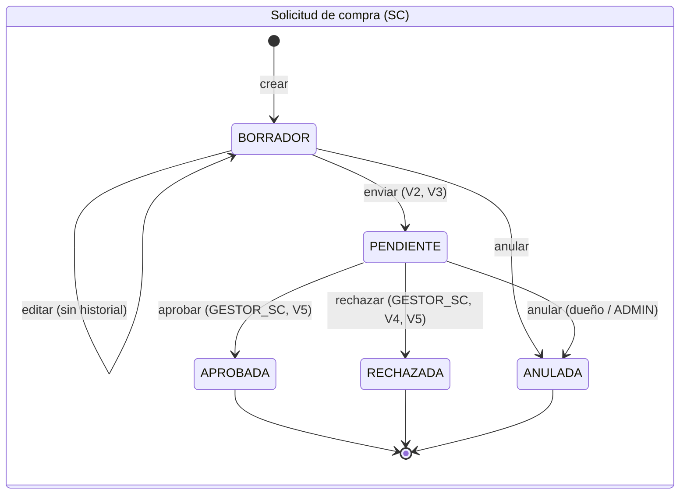
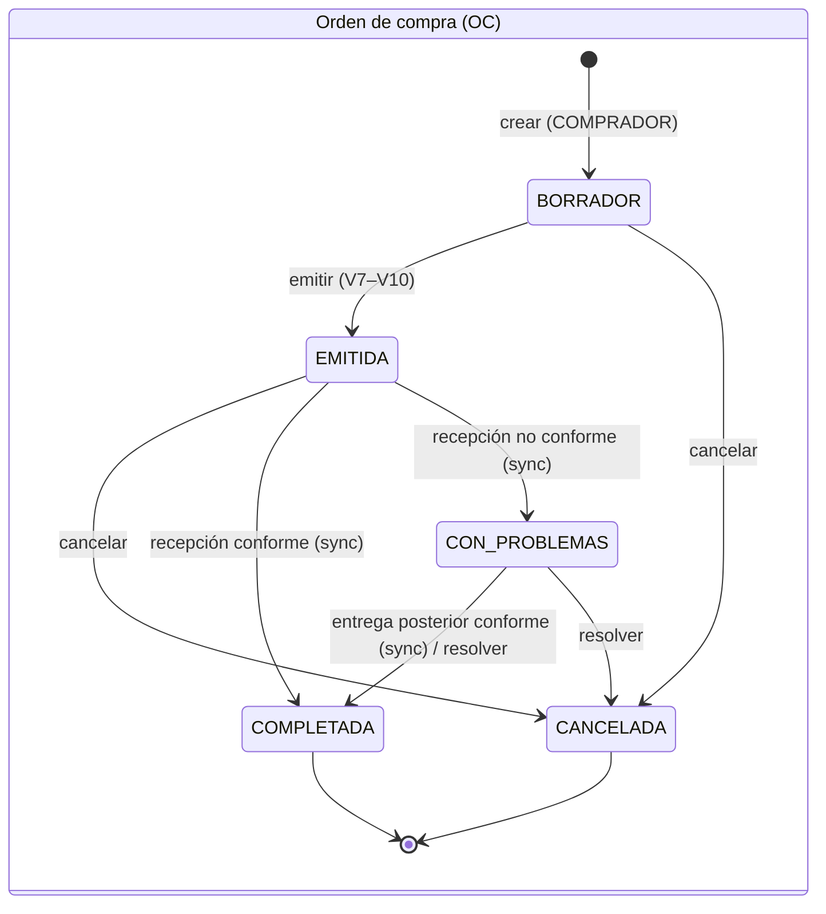

# Flujo del proceso de compras

Es el mismo proceso de [flujo-compras.bpmn](flujo-compras.bpmn) (que se abre en <https://demo.bpmn.io>), dibujado como flowchart de Mermaid con un `subgraph` por carril.

Fuentes: máquina de estados de la SC (`backend/src/solicitudes/sc.maquina.ts`), servicio de SC, `docs/decisiones.md` §2–§4 (estados, reglas V1–V11, roles) y los CHECK de `database/schema/02_ajustes_estados.sql`.

**Qué está implementado hoy y qué no.** El backend solo implementa crear, editar, enviar y anular la SC. Aprobar y rechazar existen en la máquina de estados, pero no tienen endpoint (`backend/src/aprobaciones/` está vacío). De la OC solo están las entidades: no hay endpoints, máquina de estados ni sincronización con Logística. Esa parte del flujo sale de `docs/decisiones.md`. En el diagrama, los nodos con borde punteado son pasos **especificados pero no implementados**.

**Simplificación.** El diagrama sigue una SC hasta una OC. En la realidad, una OC junta líneas de varias SC aprobadas, y una SC puede repartirse en varias OC (la relación es por línea: `compras_detalle.id_sc_detalle`).

```mermaid
flowchart LR
    %% ---------- Carril: Solicitante ----------
    subgraph SOL["Solicitante (todo empleado autenticado)"]
        direction LR
        start((Necesidad de compra))
        crearSC["Crear SC<br/>estado: BORRADOR"]
        editarSC["Completar motivo y líneas<br/>(PATCH, solo el dueño)"]
        gwBorr{"¿Qué hace con<br/>el borrador?"}
        anularB["Anular SC"]
        endAnul1(((SC ANULADA)))
        enviarSC["Enviar SC"]
        revDup["Revisar SC duplicadas<br/>y confirmar"]
        anularP["Anular SC pendiente<br/>(dueño o ADMIN)"]
        endAnul2(((SC ANULADA)))
    end

    %% ---------- Carril: Gestor SC ----------
    subgraph GES["Gestor SC (aprobador)"]
        direction LR
        revisarSC["Revisar SC pendiente<br/>(no puede ser propia, V5)"]
        gwDec{"¿Decisión?"}
        rechazar["Rechazar con motivo<br/>(V4, ≥ 10 caracteres)"]
        endRech(((SC RECHAZADA)))
        aprobar["Aprobar SC"]
    end

    %% ---------- Carril: Comprador ----------
    subgraph COM["Comprador"]
        direction LR
        selLineas["Seleccionar líneas de SC APROBADA<br/>sin OC activa"]
        crearOC["Crear / editar OC<br/>estado: BORRADOR<br/>proveedor, cantidades, precios, fecha"]
        gwOc{"¿Emitir o<br/>cancelar?"}
        cancelB["Cancelar OC<br/>(motivo)"]
        endCan1(((OC CANCELADA)))
        emitir["Emitir OC"]
        enviarProv["Generar documento OC<br/>y enviarla al proveedor"]
        gwEspOc{{"Esperar: recepción<br/>o cancelación"}}
        cancelE["Cancelar OC emitida<br/>(motivo)"]
        endCan2(((OC CANCELADA)))
        resolver["Resolver OC con problemas<br/>(resultado + comentario)"]
        gwRes{"¿Resultado?"}
        endCan3(((OC CANCELADA)))
    end

    %% ---------- Carril: Sistema ----------
    subgraph SYS["Sistema Compras (backend)"]
        direction LR
        valSC["Validar envío<br/>V2 campos · V3 duplicados"]
        gwVal{"¿Resultado?"}
        regPend["Registrar PENDIENTE<br/>+ historial"]
        gwEspSc{{"Esperar: gestor<br/>o anulación"}}
        regAprob["Registrar APROBADA<br/>id_gestor, fecha_resolucion"]
        valOC["Validar V7–V10<br/>calcular IVA 19 %"]
        gwValOc{"¿Válida?"}
        regEmit["Registrar EMITIDA<br/>(en tránsito) + historial"]
        sync["Sincronizar log_recepcion<br/>evaluar acumulado de la OC"]
        gwConf{"¿Conforme?"}
        regProb["Registrar CON_PROBLEMAS<br/>+ diferencias en historial"]
        gwEspProb{{"Esperar: nueva entrega<br/>o resolución"}}
        regComp["Registrar COMPLETADA<br/>+ fecha_recepcion_real"]
    end

    %% ---------- Carril: Logística / Bodega ----------
    subgraph LOG["Logística / Bodega (módulo externo)"]
        direction LR
        llega(["Llega mercadería<br/>con guía del proveedor"])
        regRec["Registrar recepción y verificar<br/>contra guía y OC (log_recepcion)"]
        nueva(["Llega entrega<br/>complementaria"])
        ingreso["Confirmar ingreso a Inventario<br/>(inv_movimiento)"]
        endComp(((OC COMPLETADA)))
    end

    %% ---------- Solicitud de compra ----------
    start --> crearSC --> editarSC --> gwBorr
    gwBorr -- Anular --> anularB --> endAnul1
    gwBorr -- Enviar --> enviarSC --> valSC --> gwVal
    gwVal -- "Incompleta (SC_INCOMPLETA)" --> editarSC
    gwVal -- "Posible duplicado (409)" --> revDup
    revDup -- "Reenvía con confirmarDuplicado" --> enviarSC
    gwVal -- OK --> regPend --> gwEspSc
    gwEspSc -- "Solicitante anula" --> anularP --> endAnul2
    gwEspSc -- "Gestor toma la SC" --> revisarSC --> gwDec
    gwDec -- Rechazar --> rechazar --> endRech
    gwDec -- Aprobar --> aprobar --> regAprob

    %% ---------- Orden de compra ----------
    regAprob --> selLineas --> crearOC --> gwOc
    gwOc -- Cancelar --> cancelB --> endCan1
    gwOc -- Emitir --> emitir --> valOC --> gwValOc
    gwValOc -- "No (error V7–V10)" --> crearOC
    gwValOc -- Sí --> regEmit --> enviarProv --> gwEspOc
    gwEspOc -- "Comprador cancela" --> cancelE --> endCan2
    gwEspOc -- "Proveedor despacha" --> llega --> regRec --> sync --> gwConf
    gwConf -- "Sí: recibido = pedido, 0 dañados" --> regComp
    gwConf -- "No: faltantes, dañados o sobrantes" --> regProb --> gwEspProb
    gwEspProb -- "Proveedor completa" --> nueva --> regRec
    gwEspProb -- "Comprador resuelve" --> resolver --> gwRes
    gwRes -- CANCELADA --> endCan3
    gwRes -- COMPLETADA --> regComp
    regComp --> ingreso --> endComp

    %% ---------- Estilos ----------
    classDef estadoFin fill:#e8f5e9,stroke:#2e7d32,color:#1b5e20
    classDef estadoMalo fill:#ffebee,stroke:#c62828,color:#b71c1c
    classDef noImpl stroke-dasharray:5 4
    class endComp estadoFin
    class endAnul1,endAnul2,endRech,endCan1,endCan2,endCan3 estadoMalo
    class revisarSC,gwDec,rechazar,aprobar,regAprob,selLineas,crearOC,gwOc,cancelB,emitir,valOC,gwValOc,regEmit,enviarProv,gwEspOc,cancelE,sync,gwConf,regProb,gwEspProb,resolver,gwRes,regComp noImpl
```

## Estados por documento

Valores exactos de los CHECK de la BD, que coinciden con `ESTADOS_SC` y `ESTADOS_OC` del backend.

## Roles por carril

| Carril | Rol interno (`backend/src/auth/roles.ts`) | Acciones |
|---|---|---|
| Solicitante | `SOLICITANTE` | crear, editar, enviar y anular **sus** SC |
| Gestor SC | `GESTOR_SC` | aprobar y rechazar SC ajenas |
| Comprador | `COMPRADOR` | crear, editar, emitir, cancelar y resolver OC |
| Sistema | (automático) | validaciones V2–V10, folios, IVA, historial, sincronización de recepciones |
| Logística / Bodega | otro módulo | registra `log_recepcion` y confirma el ingreso a Inventario |
| (no aparece) | `ADMIN` | anula SC ajenas, cancela OC, fuerza la sincronización |
| (no aparece) | `INVENTARIO` | solo consulta OC emitidas y tránsito |
